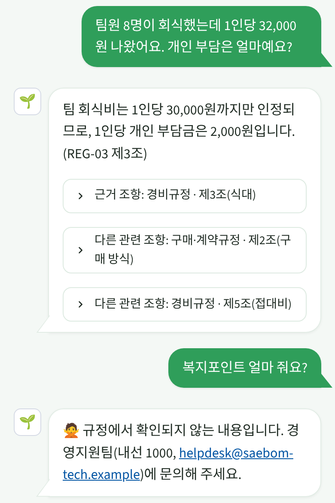

# 새봄테크 사내 규정 Q&A 챗봇 (개인 프로젝트)

> 총무 업무 중 반복되는 "규정 문의"를 자동 응대하는 RAG 챗봇입니다.
> **모든 규정은 연습용 가상 회사(주식회사 새봄테크)의 가상 데이터**이며, 실존 기업·법령과 무관합니다.

**🌱 바로 써 보기**: [배포 앱](https://saebom-policy-chatbot-fgxwitdq7dcolgqto9pmty.streamlit.app/) (PC·휴대폰, 절전 상태면 깨우는 데 1~2분)



## 무엇을 하나
- 직원이 자연어로 질문하면 관련 **규정 조항을 찾아 근거와 함께** 답합니다. 오타·일상어(예: 호텔비 → 숙박비)도 보정합니다.
- 확신 정도에 따라 **답변 / 확인 필요 / 거절** 3단계로 응답하고, 애매하면 문의처를 안내합니다.
- 답변 문장은 무료 Gemini API가 근거 조항만 사용해 만들고, 무료 한도를 넘으면 조항 원문으로 대체합니다.

## 한눈에 보는 결과
검증셋 = 개선에 한 번도 쓰지 않은 처음 보는 질문 (단계마다 한 번만 측정)

| 항목 | 시작 | 최종 |
|---|---|---|
| 근거 조항 검색 정답률 (상위 3개, 100문항) | 89% | **95%** |
| 규정 밖 질문 처리 (12문항) | 0/12 | **12/12** (검색 단계 거절 6 + 답변 단계 "확인되지 않습니다" 6) |
| 정상 질문을 잘못 거절 | - | 6% |
| "답변" 판정 시 근거 정답률 | - | 97.8% |
| 답변 문장 정확 (기본 50문항, 직접 판정) | 43 | **48** (오답 1 → 0) |

- 데이터: 가상 규정 9종·78개 조항, 평가 질문 802개 (기본 50 + 말투·오타 변형 600 + 검증 112 + 규정 밖 40)
- 기간·비용: 3일, 0원 (무료 도구만 사용)
- 역할: 기획, 규정·평가 질문 설계, 평가 기준, 개선 방향 결정, 답변 검수, 배포. 코드는 AI 코딩 도구(Claude)와 함께 작성
- 개선 과정 전체(시행착오·결정·점수): [`experiments/IMPROVEMENT_LOG.md`](experiments/IMPROVEMENT_LOG.md)

<br clear="right">

## 구조
```
chatbot/            앱과 검색 코드 (app.py가 실행 파일)
  app.py            Streamlit 채팅 화면
  pipeline.py       개선 단계(v0~v4) 누적 적용
  search_engine.py  조항 단위 분할 + 키워드(BM25) 검색
  embed_engine.py   임베딩 검색(무료 다국어 모델)
  synonyms.py       v1 동의어 사전 / v2 오타 허용 매칭
  typo_fix.py       v3 질문 오타 보정(Kiwi)
  granular.py       v4 조항 세분화 검색
  scope_guard.py    v5 규정 밖 질문 3단계 응답
  llm_answer.py     답변 문장 생성 (Gemini 무료, 지시문 v1~v3)
  answer_eval.py    답변 평가 (개발자 모드)
  hot_reload.py     코드 변경 자동 반영 (재부팅 불필요)
  evaluate*.py      평가 스크립트
regulations/        가상 규정 9종 (REG-00~08)
eval_*.csv          개발용 평가 질문 (50 / 600)
holdout_questions.csv  검증용 질문 112 (개선에 사용 금지)
oos_dev_questions.csv  개발용 규정 밖 질문 40
experiments/        점수 기록·개선 일지
data_tools/         평가 질문 생성 스크립트
```

## 내 PC에서 실행
```bash
pip install -r chatbot/requirements.txt
streamlit run chatbot/app.py
```
처음 실행 시 임베딩 모델(약 470MB)을 내려받아 1~2분 걸립니다.

## 배포 (Streamlit Community Cloud, 무료)
1. 이 저장소를 GitHub에 올림 (Public)
2. https://share.streamlit.io 에서 GitHub 계정으로 로그인 → **Create app**
3. Repository: 이 저장소 / Branch: `main` / Main file path: `chatbot/app.py`
4. Advanced settings → Python version **3.11**
5. (선택) Secrets에 `GEMINI_API_KEY = "발급받은 키"` 입력
6. Deploy → 생성된 주소를 휴대폰에서 열고 "홈 화면에 추가"

## 한계와 주의
- 가상 규정 전용. 실제 회사 규정은 공개 클라우드에 올리지 말 것(사내 승인 환경에서 운영)
- 무료 호스팅은 12시간 미사용 시 절전 → 다시 깨울 때 1~2분 소요
- 거절 기준값은 "임베딩 + v4" 조합 전용
